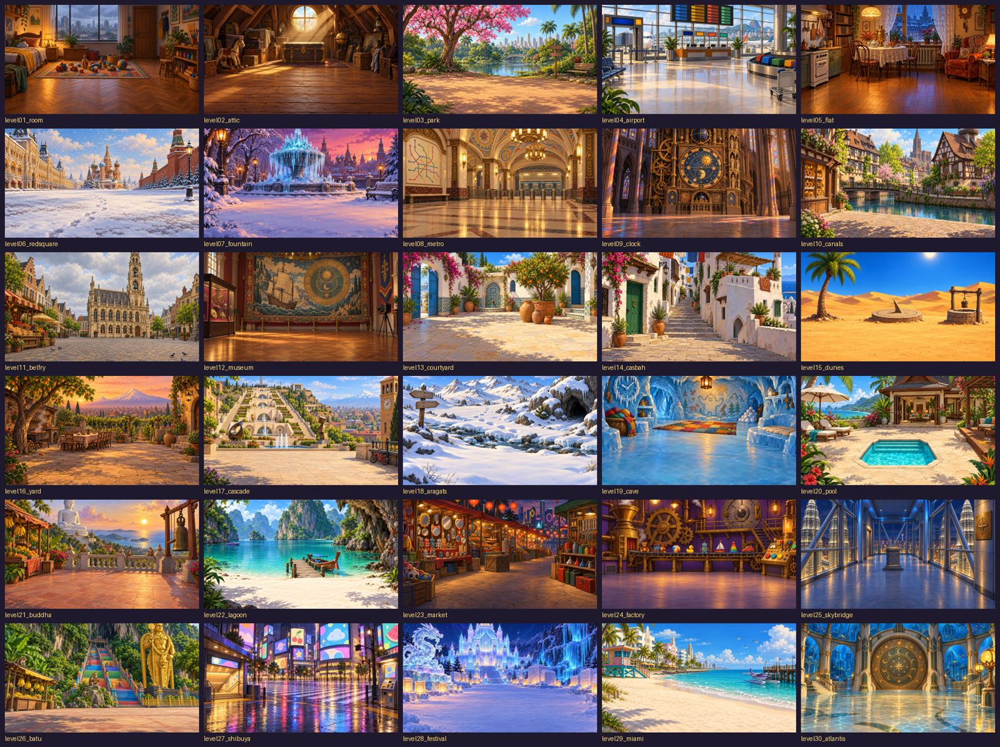
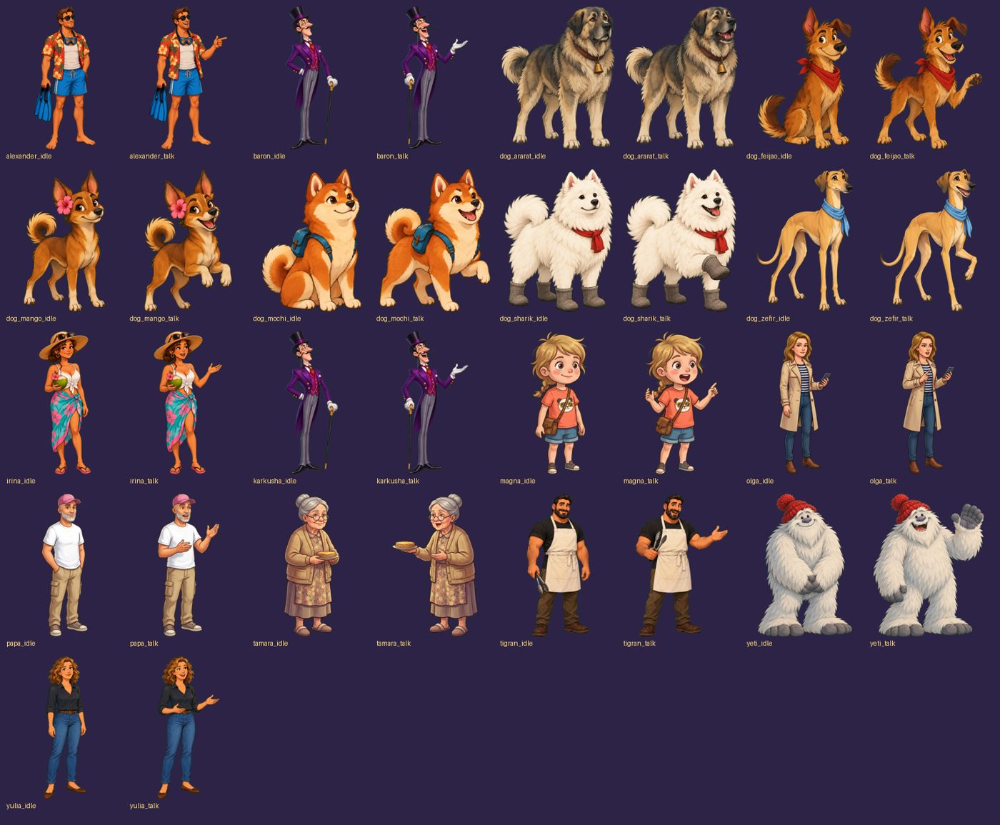
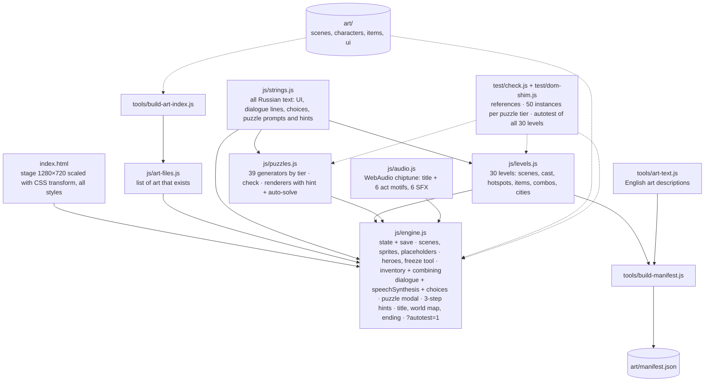

# Magna & Dad: The Compass of Atlantis

«Магна и Папа: Компас Атлантиды» — a 30-level point-and-click adventure for Magna (5) and her dad,
in the spirit of *Indiana Jones and the Fate of Atlantis*. Third game in the series
(after magna-five-stars and magna-ghost-hunters).

- Design brief: [DESIGN.md](DESIGN.md)
- Levels and difficulty ramp: [LEVELS.md](LEVELS.md)
- Art list for the painters: [art/manifest.json](art/manifest.json)
- Play: https://claude.ai/artifact/N22BUAMrNxxJqj2dVdr6fH





## How to play

Open `index.html` (double-click works, `file://` is fine), or serve the folder:

```bash
python -m http.server 8790
```

then open http://localhost:8790.

- **Tap things** in the picture: Magna or Dad walks over and looks, talks, takes or uses. Everything is spoken in Russian and shown as big text; tap anywhere to go to the next line.
- **Two heroes** (portraits at the bottom left): high or heavy jobs need **Dad**, small or low jobs need **Magna**. When **Snezhana** ❄️ is with you, tap her portrait and then something wet to freeze it.
- **Backpack**: tap an item, then the thing to use it on. Tap one item and then another to **combine** them (map pieces, rope + hook, the Compass and its rings).
- **Puzzles** open in a big window. The first puzzle of each kind is a demo: Dad explains and the answer glows. Wrong answers just shake.
- **💡** gives three hints in a row: a nudge, an arrow, then the answer. A level finished without hints earns a second ⭐.
- **⏭** (small, for Dad) skips a puzzle. **🔊** turns sound and speech on/off. **☰** goes to the title screen.
- Progress saves itself after every puzzle and level. The title screen has Continue, New game and the level select (unlocked levels only).
- **Dad-code**: on the title screen tap ☀️ three times, 🌙 once, ⭐ four times (or type `314`) to unlock every level.

The game runs fully without any art: missing pictures are drawn as labelled placeholders and hotspot outlines.

## Story

```mermaid
flowchart TD
  subgraph A1[Act 1 · São Paulo]
    L1[1 Room: tidy up → Mum's old key] --> L2[2 Attic: sailor's chest → Compass + map piece]
    L2 --> L3[3 Ibirapuera: Feijão and the Dog Union → bone whistle]
    L3 --> L4[4 Airport: Baron's crow steals the map piece]
  end
  subgraph A2[Act 2 · Moscow]
    L5[5 Grandma's flat: blini + diary riddle] --> L6[6 Red Square: Sharik, Baron's footprints]
    L6 --> L7[7 Frozen fountain: free Snezhana, map piece back]
    L7 --> L8[8 Metro: riddle = Strasbourg]
  end
  subgraph A3[Act 3 · Europe]
    L9[9 Astronomical clock → stork] --> L10[10 Canals: freeze, stork nest → map piece 2]
    L10 --> L11[11 Oudenaarde belfry → key]
    L11 --> L12{{12 Tapestry: three rings · choice: chase or trick Karkusha}}
  end
  subgraph A4[Act 4 · Algeria]
    L13[13 Family courtyard: the aunt's story] --> L14[14 Casbah: rope + hook → roof]
    L14 --> L15[15 Sahara noon well → ☀️ Sun ring]
  end
  subgraph A5[Act 5 · Yerevan]
    L16[16 Tigran & Yulia: Liliana's lamb, Maya's drawing] --> L17[17 Cascade: bike race with the crow]
    L17 --> L18[18 Aragats: ice bridge, giant tracks]
    L18 --> L19{{19 Yeti Boba: blini → 🌙 Moon ring · choice: gift for Boba}}
  end
  subgraph A6[Act 6 · Asia and Atlantis]
    L20[20 Phuket pool: swimming lesson → map piece 3] --> L21[21 Big Buddha: monkeys, bell]
    L21 --> L22[22 Lagoon boat → ⭐ Star ring]
    L22 --> L23{{23 Shekou market · choice: oil Karkusha's wing}}
    L23 --> L24[24 Baron's factory → centre disc]
    L24 --> L25[25 Petronas skybridge: Compass assembled, monkeys steal it]
    L25 --> L26[26 Batu caves: Feijão flies in, Compass back]
    L26 --> L27[27 Shibuya: find the disguised Baron]
    L27 --> L28[28 Hokkaido: Compass points to Miami]
    L28 --> L29[29 Miami: whistle for Boba, the dogs howl the seaplane down]
    L29 --> L30{{30 Atlantis: three-ring gate, Mum's password · choice: take or leave the golden light}}
  end
  L4 -- plane --> L5
  L8 -- plane --> L9
  L12 -- plane --> L13
  L15 -- plane --> L16
  L19 -- plane --> L20
  L12 -. how Karkusha greets you .-> L23
  L23 -. Karkusha helps or not .-> L24
  L23 -.-> L29
  L19 -. what Boba brings .-> L29
  L30 --> END([Everyone at Grandma's table in Moscow. «А теперь — спать!»])
```



## Code



## Tests

```bash
node test/check.js
```

checks that every level uses only existing puzzle, character, item and manifest ids (and that the
puzzles match LEVELS.md), that every puzzle generator produces a solvable instance 50 times per tier,
and runs the engine's autotest for all 30 levels in a tiny DOM shim (three runs, one per dialogue-choice variant).

In a browser, `index.html?autotest=1` plays every level programmatically and prints `PASS`/`FAIL` per level to the console.

## Art

All pictures were generated with image models driven through Chrome (Gemini in one profile, ChatGPT in another)
from the English descriptions in `art/manifest.json`, in one consistent "remastered LucasArts" style:

- characters: one green-screen sheet per character with two poses (idle, talking), split and keyed out by
  `tools/keyout.py`; the children and the princess came from Gemini (ChatGPT's filter refuses child characters);
- scenes: 30 backgrounds painted without people, cropped to 1280×720; hotspot rectangles in `js/levels.js` were
  then moved to where the objects actually are;
- items: three green-screen grids split into 128×128 icons by `tools/grid.py`;
- `tools/clip.ps1` saves the clipboard image (ChatGPT's "Copy image" button) straight into the pipeline.

Art is painted separately and copied into `art/` (`scenes/`, `characters/`, `items/`, `ui/`) with the file names from
`art/manifest.json`. After copying, run

```bash
node tools/build-art-index.js
```

so the game loads the new pictures (it requests only listed files, so missing art never causes console errors).
To change hotspot rectangles or descriptions, edit `js/levels.js` / `tools/art-text.js` and run `node tools/build-manifest.js`.
